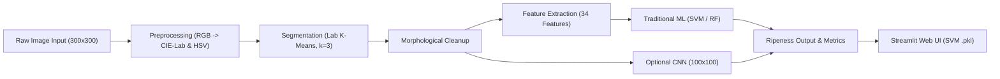

# Fruit Ripeness Detection Using Colour Segmentation and Machine Learning

An end-to-end Computer Vision and Machine Learning university mini project to classify fruit ripeness stages (*Unripe*, *Ripe*, *Overripe*) through CIE-Lab K-Means colour segmentation, morphological cleanup, statistical colour features, traditional ML, and an optional Deep Learning (CNN) benchmark.

---

## 📌 Project Overview

- **Project Title:** Fruit Ripeness Detection Using Colour Segmentation and Machine Learning
- **Core Objective:** Develop an automated visual inspection system that segments fruit foreground pixels using CIE-Lab K-Means clustering, extracts multi-colour space features, and classifies the ripeness stage across 3 classes (`Unripe`, `Ripe`, `Overripe`). (The task is ripeness classification only, not fruit variety classification.)
- **Supported Fruits (5):**
  1. Apple
  2. Banana
  3. Mango
  4. Orange
  5. Tomato
- **Ripeness Stages (3):**
  1. `Unripe`
  2. `Ripe`
  3. `Overripe`

---

## 📁 Project Directory Structure

```text
FRUITS-DETECTION-/
│
├── dataset/
│   ├── ripeness/                 # Gitignored image folders (not stored in the repo)
│   ├── ripeness_splits.csv       # 70/15/15 stratified train/val/test split (seed 42, 4,047 images)
│   ├── ripeness_manifest.csv     # Deduplicated image manifest with metadata and hashes
│   ├── manifest.csv              # Ground-truth mask manifest header
│   ├── mask_manifest.csv         # Segmentation mask manifest
│   ├── LICENSES.csv              # Dataset source and licence metadata
│   ├── annotation_queue/         # Sample fruit photos (used by the Streamlit app demo selector)
│   └── rejected_handsourced/     # Archived earlier handsourced data (not used in final pipeline)
│
├── notebooks/
│   └── README.md
│
├── src/                          # Python source modules
│   ├── __init__.py
│   ├── preprocessing.py          # Pillow + NumPy image loading, RGB->HSV, RGB->CIE-Lab
│   ├── segmentation.py           # K-Means foreground isolation & SciPy morphological cleanup
│   ├── rebuild_ripeness_splits.py# Near-duplicate aHash/SHA-256 merging & 70/15/15 split builder
│   ├── run_final_pipeline.py     # End-to-end segmentation, 34-dim feature extraction, ML & report
│   ├── train_cnn.py              # Optional TensorFlow small CNN benchmark (100x100 segmented input)
│   ├── build_ripeness_manifest.py# Manifest builder for dataset/ripeness/
│   ├── ripeness_loader.py        # Ripeness dataset CSV/directory loader
│   └── ...                       # Earlier / unused experimental & scaffolding scripts
│
├── models/
│   ├── ripeness_classifier.pkl   # Saved tuned SVM (RBF) + StandardScaler + class metadata
│   └── ripeness_cnn.keras        # Saved optional TensorFlow CNN model
│
├── results/
│   ├── final/                    # Final report (results.md), features.csv, CMs & 12 example sheets
│   ├── phase2_ripeness_inventory/# Split sample grids
│   ├── phase3/                   # Segmentation overlay images
│   └── archive_handsourced/      # Archived earlier outputs
│
├── app/
│   └── app.py                    # Streamlit interactive web application (uses SVM .pkl)
│
├── requirements.txt              # Python dependencies
├── .gitignore                    # Git ignore configuration
└── README.md                     # Project documentation
```

---

## ⚙️ Technical Stack

- **Language:** Python (see `requirements.txt`; OpenCV and Pandas are not used)
- **Image Processing & Vision:** Pillow (`PIL`), NumPy, SciPy (`scipy.ndimage`)
- **Machine Learning:** Scikit-Learn (`SVC`, `RandomForestClassifier`, `StandardScaler`, metrics)
- **Deep Learning (Optional Extension):** TensorFlow / Keras (CNN)
- **Web Interface:** Streamlit
- **Data I/O:** Python standard library `csv` and `pickle`

---

## 🔬 Methodology & Pipeline



1. **Preprocessing:** Load 300×300 RGB images via Pillow (compositing alpha onto white) and convert pixels to HSV (`H: 0–179, S: 0–255, V: 0–255`) and CIE-Lab (`L, a, b: 0–255`) using pure NumPy.
2. **Segmentation & Cleanup:** Segment fruit foreground using CIE-Lab K-Means clustering (`k=3`) followed by foreground cluster isolation and morphological cleanup (opening, closing, hole filling, largest connected component).
3. **Feature Extraction (34 features):** Extract mean and standard deviation across RGB, HSV, and CIE-Lab channels (18 features) plus a 16-bin histogram over hue `0–180` (16 features; no skewness).
4. **Classification Models:**
   - **Support Vector Machine (SVM):** RBF kernel on standardized 34-dim features, tuned on validation (`C=25.0`, `gamma=0.05`) and saved to `models/ripeness_classifier.pkl`.
   - **Random Forest:** Ensemble decision trees tuned on validation (`n_estimators=50`, `max_depth=12`).
   - **Small CNN (Optional):** 3-layer Conv2D + MaxPooling2D + GlobalAveragePooling2D + Dropout + Dense(64) + Dense(3) trained on 100×100 segmented fruit images and saved to `models/ripeness_cnn.keras`.
5. **Evaluation & App:** Metrics and confusion matrices are written to `results/final/results.md`. Note that the Random Forest is evaluated in the pipeline report but is not saved to disk; the Streamlit app (`app/app.py`) loads `models/ripeness_classifier.pkl` and uses the saved SVM.

---

## 🚀 How to Run

Run all commands from the repository root (`FRUITS-DETECTION-`) in this order:

1. **Create and activate a virtual environment (optional, Windows PowerShell):**

   ```powershell
   python -m venv venv
   .\venv\Scripts\Activate.ps1
   ```

2. **Install dependencies:**

   ```bash
   pip install -r requirements.txt
   ```

3. **Rebuild stratified splits** *(needs `dataset/ripeness/`, which is gitignored and not in the repo)*:

   ```bash
   python src/rebuild_ripeness_splits.py
   ```

4. **Run the main ML pipeline** *(needs the images in `dataset/ripeness/`)*:

   ```bash
   python src/run_final_pipeline.py
   ```

5. **Train the optional CNN** *(run AFTER `run_final_pipeline.py`, as it appends Section 6 to `results/final/results.md`)*:

   ```bash
   python src/train_cnn.py
   ```

6. **Launch the Streamlit web app** *(needs only `models/ripeness_classifier.pkl` and `dataset/annotation_queue/` samples)*:

   ```bash
   streamlit run app/app.py
   ```

---

## 📊 Dataset Policy & Integrity

- **Dataset source:** NOT RECORDED - to be filled by author
- **Ripeness Ground Truth:** Labels represent genuine ripeness stages (`Unripe`, `Ripe`, `Overripe`) across 5 fruits (`apple`, `banana`, `mango`, `orange`, `tomato`) in a 70/15/15 stratified split (`Train: 2,832`, `Val: 607`, `Test: 608`; total `4,047` images) with near-duplicate grouping (`seed=42`).
