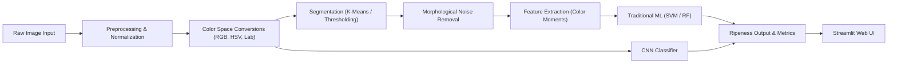

# Fruit Ripeness Detection Using Colour Segmentation and Machine Learning

An end-to-end Computer Vision and Machine Learning college project to classify fruit varieties and identify their ripeness stage (*Unripe*, *Ripe*, *Overripe*) through color space transformation, segmentation, statistical color features, traditional ML, and Deep Learning (CNN).

---

## 📌 Project Overview

- **Project Title:** Fruit Ripeness Detection Using Colour Segmentation and Machine Learning
- **Core Objective:** Develop an automated visual inspection system that accepts fruit images, performs color segmentation, extracts multi-color space features, and classifies the ripeness level.
- **Supported Fruits:**
  1. Banana
  2. Mango
  3. Papaya
  4. Apple
  5. Orange
  6. Tomato
- **Ripeness Stages:**
  1. `Unripe`
  2. `Ripe`
  3. `Overripe`

---

## 📁 Project Directory Structure

```text
Fruit-Ripeness-Detection/
│
├── dataset/
│   ├── raw/                  # Original raw images categorized by fruit and ripeness
│   │   ├── apple/            # unripe/, ripe/, overripe/
│   │   ├── banana/           # unripe/, ripe/, overripe/
│   │   ├── mango/            # unripe/, ripe/, overripe/
│   │   ├── orange/           # unripe/, ripe/, overripe/
│   │   ├── papaya/           # unripe/, ripe/, overripe/
│   │   └── tomato/           # unripe/, ripe/, overripe/
│   └── processed/            # Standardized, resized, and segmented images
│       ├── apple/
│       ├── banana/
│       ├── mango/
│       ├── orange/
│       ├── papaya/
│       └── tomato/
│
├── notebooks/                # Exploratory Jupyter Notebooks for experiments
│   └── README.md
│
├── src/                      # Core modular Python source code
│   ├── __init__.py           # Package initializer
│   ├── preprocessing.py      # Resizing, normalization, color space conversions
│   ├── segmentation.py       # HSV thresholding, K-means clustering, morphological cleanup
│   ├── feature_extraction.py # Statistical color moments (RGB, HSV, Lab) and histograms
│   ├── train_ml.py           # Traditional ML classifiers (SVM & Random Forest)
│   ├── train_cnn.py          # Deep Learning CNN architecture and training
│   ├── predict.py            # End-to-end inference & latency benchmarking
│   └── utils.py              # Plotting, confusion matrix generation, metric exporters
│
├── models/                   # Saved model weights (.joblib, .keras)
├── results/                  # Evaluation figures, confusion matrices, and metrics CSVs
│   ├── figures/
│   └── metrics/
│
├── app/                      # Streamlit interactive web application
│   └── app.py
│
├── requirements.txt          # Python dependencies
├── .gitignore                # Git ignore configuration
└── README.md                 # Project documentation
```

---

## ⚙️ Technical Stack

- **Language:** Python 3.9+
- **Image Processing & Vision:** OpenCV (`cv2`), Pillow (`PIL`)
- **Scientific Computing & Data:** NumPy, Pandas
- **Visualization:** Matplotlib, Seaborn
- **Machine Learning:** Scikit-Learn (SVM, Random Forest, metrics)
- **Deep Learning:** TensorFlow / Keras (CNN)
- **Web Interface:** Streamlit

---

## 🔬 Methodology & Pipeline



1. **Preprocessing:** Standardize input resolution (224x224), convert to float normalization [0, 1].
2. **Color Space Transformations:** Examine variations across RGB, HSV (hue invariance), and CIE-Lab (perceptual color uniformity).
3. **Segmentation & Denoising:** Segment fruit foreground with HSV thresholding / K-Means clustering, followed by morphological opening and closing.
4. **Feature Extraction:** Compute color moments (Mean, Standard Deviation, Skewness) across all 9 color channels, plus color histograms.
5. **Classification Models:**
   - **Support Vector Machine (SVM):** Non-linear RBF kernel on scaled color features.
   - **Random Forest:** Ensemble decision trees.
   - **Convolutional Neural Network (CNN):** 2D convolutional feature extractor trained directly on pixel data.
6. **Evaluation Metrics:** Accuracy, Precision, Recall, Macro F1-score, Confusion Matrix, and Inference Latency (ms).

---

## 🚀 Getting Started

### 1. Prerequisites & Environment Setup

Create and activate a virtual environment:

```bash
# Windows (PowerShell)
python -m venv venv
.\venv\Scripts\Activate.ps1
```

Install required dependencies:

```bash
pip install -r requirements.txt
```

### 2. Launch the Web Interface

```bash
streamlit run app/app.py
```

---

## 📊 Dataset Policy & Integrity

- **Fruits-360 Reference:** Used for fruit category reference; note that Fruits-360 labels represent variety rather than ripeness stages.
- **Ripeness Ground Truth:** Datasets must provide genuine labels for `Unripe`, `Ripe`, and `Overripe`. No synthetic or fake datasets will be introduced.
